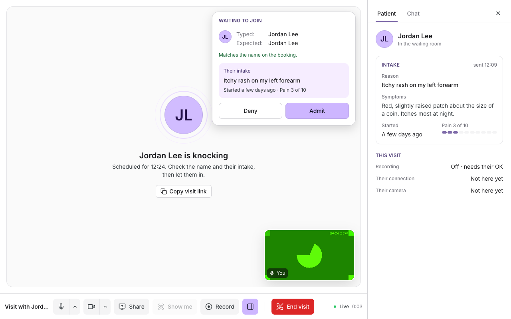
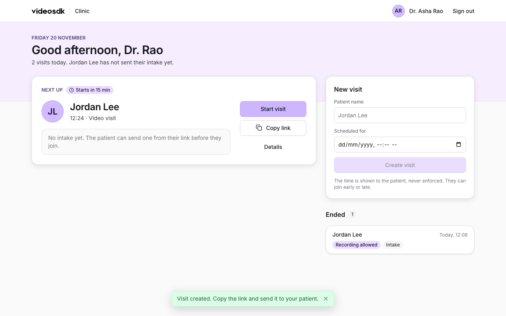
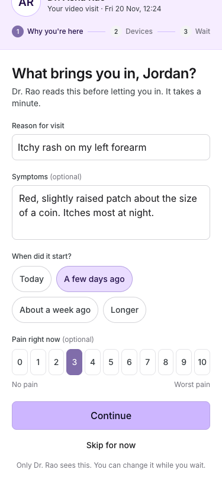
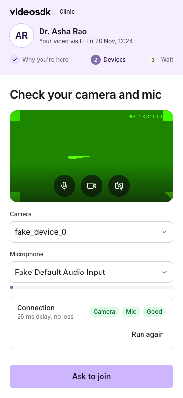
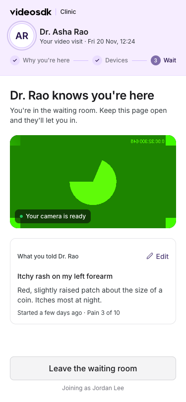
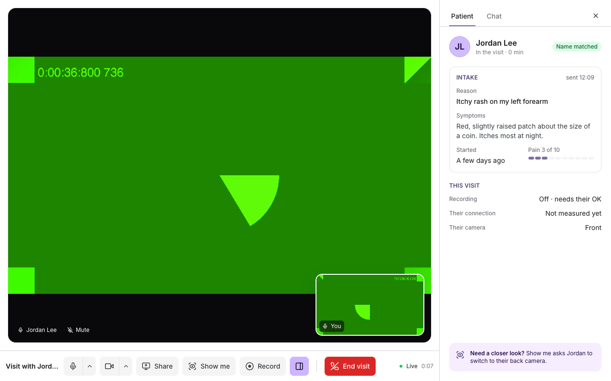
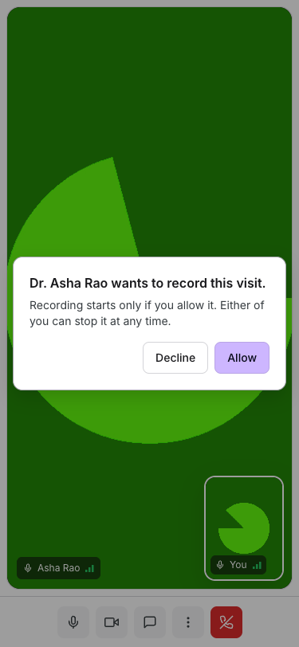
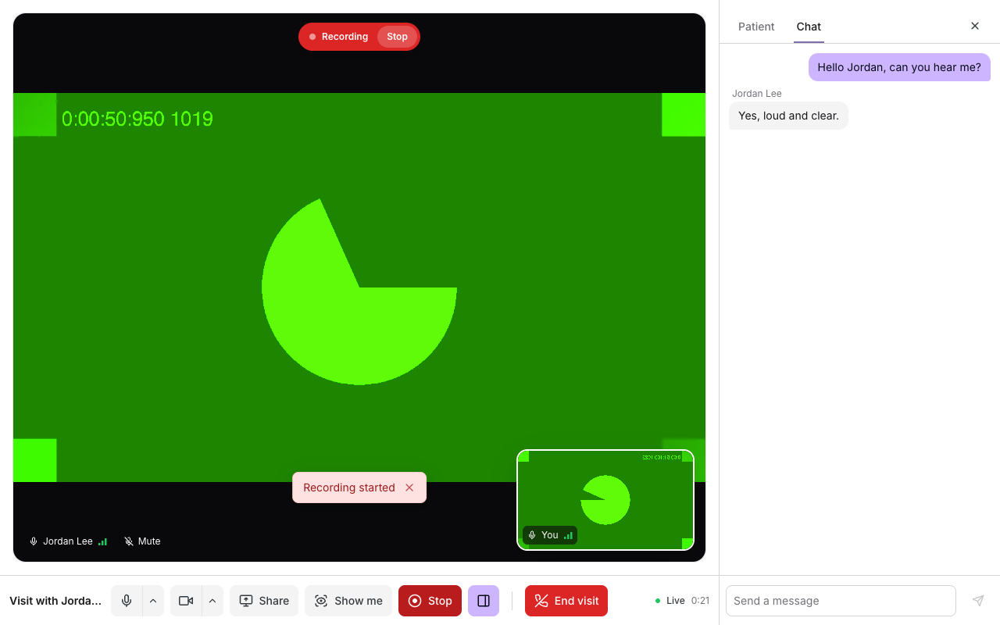
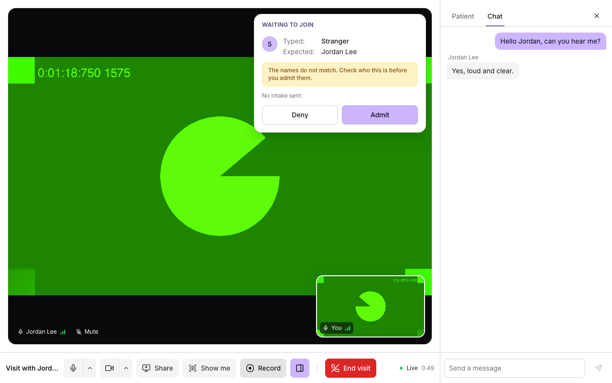
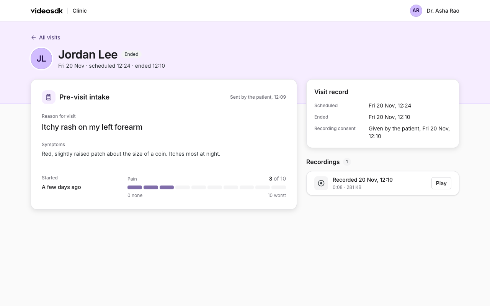

<div align="center">

# Clinic

**An open-source telehealth app built with React and VideoSDK for HIPAA-ready video consults.**

Compliance also requires VideoSDK's HIPAA add-on, signed BAAs with VideoSDK and Supabase, and your own safeguards. Supabase stores patient health information from intake. HIPAA is not a certification.



[](https://videosdk.live) [](https://react.dev) [](https://www.typescriptlang.org) [](https://vite.dev) [](LICENSE) [](https://clinic-by-videosdk.vercel.app)

[Live demo](https://clinic-by-videosdk.vercel.app) · [Quick start](#quick-start) · [How it works](#how-it-works) · [HIPAA-ready](#hipaa-ready-and-what-that-means) · [Telehealth docs](https://docs.videosdk.live/react/guide/use-cases/telehealth)

</div>

A telehealth consult needs a way to admit the patient, ask before recording, and recover when their connection drops. We built Clinic around that flow: one doctor, one patient, with VideoSDK handling the entire real-time layer. Supabase handles doctor sign-in and visit storage, including intake; patients enter through an anonymous identity behind the scenes.

[Try the live demo](https://clinic-by-videosdk.vercel.app) or [clone the repo](#quick-start).

## Why Clinic?

- Review before admitting. The waiting room shows the typed name beside the expected name, with the knocking patient's intake and a warning when names differ.
- Check devices before the knock. VideoSDK checks the camera, mic and network without entering the room, and a poor result never blocks joining.
- Ask before recording. The patient can allow or decline each request, and either participant can stop a recording. Consent is enforced by Clinic's UI, not the SDK.
- Recover the visit. The doctor's client recognizes an admitted patient's reconnect, so the doctor doesn't need to approve the same person again.
- With **Show me**, the doctor asks for a closer look, and the patient can switch to their back camera with one tap. The back-camera path still needs verification on a real phone.
- Run the whole flow yourself. `scripts/drive.mjs` drives doctor and patient browsers through intake, admission, consent, a network drop and the ended visit.

## Screenshots

Camera feeds below use Chromium's fake camera, shown as a green test pattern.

**Create a visit with a patient name and time, then copy the link.**



**Patients can fill in the intake on their phone or skip it.**



**Check the camera, mic and connection before asking to join.**



**Patients wait for admission and can edit their intake while they wait.**



**The doctor keeps the patient's intake beside the video consult.**



**The patient chooses Allow or Decline when the doctor requests recording.**



**Both participants see when recording is running and can stop it.**



**A second knock gets its own card, with a warning when the name doesn't match.**



**The visit details keep the intake, consent record and recordings together.**



## Quick start

```bash
git clone https://github.com/videosdk-community/clinic
cd clinic && pnpm install
cp .env.example .env          # fill in the values, see Installation
pnpm exec vercel login && pnpm exec vercel link
pnpm dev:api                  # http://localhost:3000
```

Complete the environment and Supabase setup below before starting the app. Use `pnpm dev:api` because it serves both the React app and `api/` functions on port 3000. `pnpm dev` runs Vite alone, for UI work without the API.

## Installation

### Prerequisites

- Node 22 or newer and pnpm.
- A [VideoSDK account](https://dub.sh/X5Fn46e?utm_source=clinic&utm_medium=github&utm_campaign=clinic_readme&utm_content=prereq) with an API key and secret from the dashboard.
- A [Supabase](https://supabase.com) project.
- A Vercel account for local `vercel dev` and deployment.

### Environment

Fill in `.env` using [.env.example](.env.example):

```dotenv
# Server-only. Never prefix these with VITE_.
VIDEOSDK_API_KEY=
VIDEOSDK_SECRET=
SUPABASE_SERVICE_ROLE_KEY=

# Safe in the browser. These are meant to ship.
VITE_SUPABASE_URL=
VITE_SUPABASE_PUBLISHABLE_KEY=

# Server-only. Used by the Supabase CLI for db push, not at runtime.
SUPABASE_DB_PASSWORD=
```

The first five values run the app. Get the VideoSDK key and secret from your [VideoSDK dashboard](https://dub.sh/X5Fn46e?utm_source=clinic&utm_medium=github&utm_campaign=clinic_readme&utm_content=env). `pnpm build` fails if a server-only environment name or value reaches `dist/`, including sourcemaps.

### Supabase

Run the repo's CLI commands against your project:

```bash
pnpm exec supabase link --project-ref <your-ref>
pnpm exec supabase db push
pnpm exec supabase config push
```

The three migrations create the visits table with owner-scoped row-level security, add intake fields, and schedule deletion of anonymous accounts older than 30 days. The auth config enables anonymous sign-ins for patients and the local redirect allowlist at `http://localhost:3000/**`.

Add your deployed domain to the redirect allowlist too, so doctor magic links can return to the app. Anonymous sign-ins default to 30 per hour per IP; raise that limit if many patients share a network. For development, `node scripts/dev-session.mjs <email>` signs a test doctor in without the rate-limited email sender.

## How it works

### How to build a telehealth app with React and VideoSDK

Start with Clinic's visit flow. A doctor signs in by magic link, creates a visit and shares its `/v/:roomId` link. The patient enters a name, optionally fills in intake, checks devices and knocks. The scheduled time is displayed, never enforced; Clinic has no calendar, booking system or reminders.

VideoSDK provides rooms and tokens, the waiting room, audio and video, PubSub chat, screen sharing, recording, pre-call checks and reconnection. Supabase stores visits and handles authentication; Vercel serves the app and API functions. Clinic shares its stack and many design decisions with [Classroom](https://github.com/videosdk-community/classroom).

### Derive permissions on the server

`POST /api/session { roomId }` verifies the caller with Supabase `getUser`, then reads the visit. It derives permissions from ownership and the admitted-patient list. Client-supplied roles, permissions and participant IDs have no say.

| Caller | Token permissions | Behavior |
|---|---|---|
| Doctor who owns the visit | `['allow_join', 'allow_mod']` | Joins with moderator permissions. |
| Previously admitted patient | `['allow_join']` | Returns without knocking. |
| Anyone else | `['ask_join']` | Knocks and waits. |

The server signs an HS256 JWT with `node:crypto`, so it needs no JWT dependency. Its `version: 2` payload binds `roomId` and `participantId` to the visit and verified user. Tokens last 600 seconds and are checked at join, so expiry doesn't interrupt an active participant.

The response's `role` chooses UI controls; token permissions enforce access. Patients receive names and time through this response, so they need no read access to the `public.visits` table. Ending the visit sets `visits.ended_at`, stops new tokens and makes the link show "Visit ended".

### Keep SDK changes in one directory

Only `src/sdk/` imports `@videosdk.live/react-sdk`, so an SDK upgrade touches one directory. `pnpm lint` enforces the boundary, including deep imports. Each SDK hook call opens its own subscription, so bridges subscribe to each hook once and write to an external store that feature code reads. Media helpers live in `src/sdk/media/`, while chat, consent, Show me and network reports use unpersisted PubSub topics.

### Record consent before starting recording

The doctor sends a request over the `CONSENT` topic. When the patient allows it, their client first saves consent through `POST /api/consent`, then publishes the answer. The doctor's client starts recording only when the sender and request ID match the pending request. Declining records nothing, and either participant can stop a running recording.

This is a contract between Clinic's two UIs. The SDK does not enforce consent, and a modified client can call recording APIs directly. The saved consent row provides the audit trail.

### Let an admitted patient reconnect

Admission saves the patient's verified user ID through `POST /api/admit`. During a network reconnect, the doctor's client checks a fresh knock against that list and admits a match automatically. The doctor must remain in the room for this path.

A reload instead fetches a new `allow_join` token, so the patient returns without knocking. This works in the same browser, where their anonymous identity is stored; a new device knocks again.

One admission gap remains: returning patients with `allow_join` also receive entry requests. Their UI ignores them, but they could admit a stranger through devtools. A matching display name also isn't proof of identity; the doctor still decides whom to admit.

## Verify it with scripts/drive.mjs

With `.env` filled in, Chrome installed and `pnpm dev:api` running:

```bash
node scripts/drive.mjs
```

Pass a deployed URL as the first argument to run against it. The script opens separate doctor and patient browser contexts, confirms the cameras are fake, and drives a two-party visit. It checks intake edits, admission, chat, screen sharing, device switching and Show me. It then exercises recording decline and approval, patient stop, network reconnect, stranger denial, rejoin and the ended link.

Screenshots go to `./drive-out/`. The script fails at the first missing step and prints `ALL FLOWS PASSED` on success. Run it after changes to the room, lobby, recording or reconnect paths. It uses a test doctor and clears that doctor's earlier visits on each run.

## Deploy to Vercel

[](https://vercel.com/new/clone?repository-url=https%3A%2F%2Fgithub.com%2Fvideosdk-community%2Fclinic&env=VIDEOSDK_API_KEY,VIDEOSDK_SECRET,SUPABASE_SERVICE_ROLE_KEY,VITE_SUPABASE_URL,VITE_SUPABASE_PUBLISHABLE_KEY&envDescription=Five%20runtime%20values%20from%20VideoSDK%20and%20Supabase&envLink=https%3A%2F%2Fdub.sh%2FX5Fn46e%3Futm_source%3Dclinic%26utm_medium%3Dgithub%26utm_campaign%3Dclinic_readme%26utm_content%3Ddeploy_btn)

Supply the five runtime environment values. `vercel.json` runs `pnpm build`, serves `dist/` and routes app URLs to the SPA while preserving `api/` routes. After deployment, run the Supabase migrations and add the deployed origin to Supabase's redirect allowlist.

## Project structure

| Path | What it contains |
|---|---|
| `api/` | Visit creation, tokens, admission, consent, intake and recordings; shared server helpers in `_lib/`. |
| `src/sdk/` | SDK bridges, store, PubSub topics and media helpers. The only SDK importer. |
| `src/screens/` | Dashboard, sign-in, patient entry, intake, pre-call check, room and visit details. |
| `src/components/` | Knock card, patient panel, chat, controls, consent prompts and recordings. |
| `src/session/` | Fetches the visit session before pre-call checks and room entry. |
| `src/domain/` | Visit types. |
| `src/design/` | VideoSDK design tokens and UI primitives. |
| `src/lib/` | Supabase and API clients, visits, recordings and helpers. |
| `supabase/` | Database migrations and auth configuration. |
| `scripts/` | Browser verification, test sign-in and bundle-secret checks. |
| `docs/DECISIONS.md` | Settled decisions and measured behavior. |

## Scripts

| Command | What it does |
|---|---|
| `pnpm dev:api` | App and API on port 3000 through `vercel dev`. Use this for a full visit. |
| `pnpm dev` | Vite alone, without `/api`, for UI work. |
| `pnpm build` | TypeScript check, Vite build and bundle-secret check. |
| `pnpm lint` | oxlint, including the SDK import boundary. |
| `node scripts/drive.mjs [baseUrl]` | Doctor and patient flow in headless Chrome with fake devices. |
| `node scripts/dev-session.mjs <email>` | Signs a test doctor in without email. |
| `node scripts/link.mjs <email>` | Returns a redeemed session as JSON to seed a test browser. |

## HIPAA-ready, and what that means

Compliance requires VideoSDK's HIPAA add-on, signed BAAs with VideoSDK and Supabase, and your own safeguards. Intake stores patient health information in Supabase, so VideoSDK's BAA alone doesn't cover that storage. HIPAA is not a certification.

Clinic avoids every feature [VideoSDK's HIPAA guide](https://www.videosdk.live/blog/hipaa-compliant-video-conferencing-api) lists as switched off under the add-on: live transcription and closed captions, post-call transcription, AI summaries, and HLS/RTMP. That guide lists recording and session-only chat as staying on. It doesn't list screen sharing, pre-call checks, the waiting room or network quality as on or off. Clinic does not enable E2EE, which disables recording.

Enable the add-on under **Billing > Add-ons** in the [VideoSDK dashboard](https://dub.sh/X5Fn46e?utm_source=clinic&utm_medium=github&utm_campaign=clinic_readme&utm_content=hipaa), then request the BAA at [security@videosdk.live](mailto:security@videosdk.live). The add-on is available on pay-as-you-go and Enterprise plans.

Every vendor storing patient data needs its own BAA. Your access controls, audit practices, retention rules and policies remain your responsibility. Use [your own recording bucket](https://docs.videosdk.live/react/guide/video-and-audio-calling-api-sdk/recording/recording-storage-config) for production; the demo uses VideoSDK's default storage.

## FAQ

### How do I build a telehealth app with React?

Clone Clinic, complete [Installation](#installation), and run `pnpm dev:api`. Create a visit as the doctor, open its link as the patient, and follow intake through admission. Use the [VideoSDK telehealth docs](https://docs.videosdk.live/react/guide/use-cases/telehealth) when adapting the flow.

### Is Clinic HIPAA-ready?

Clinic is HIPAA-ready, but compliance also requires VideoSDK's HIPAA add-on, signed BAAs with VideoSDK and Supabase, and your own safeguards. Supabase stores patient health information from intake. HIPAA is not a certification. See [what HIPAA-ready means](#hipaa-ready-and-what-that-means).

### How does the virtual waiting room work?

A new patient receives `ask_join` and knocks. The doctor sees their typed name, expected name and matching intake, then admits or denies. A mismatch warns the doctor without disabling **Admit**, because a parent or carer may knock.

### Can patients join from a phone without an account?

Yes. Patients open the link in a phone browser with nothing to install and no email or sign-up screen. Supabase creates an anonymous identity behind the scenes.

### Where are recordings stored, and can I use my own bucket?

The demo uses VideoSDK's default storage. For production, configure [your own storage bucket](https://docs.videosdk.live/react/guide/video-and-audio-calling-api-sdk/recording/recording-storage-config). The visit owner can list recordings on the details page; patients have no recordings route.

### Can I add an interpreter or more than two people?

Clinic is designed for one doctor and one patient. It has no interpreter, family or nurse role. Phone dial-in, file sharing, visit notes and EHR integration are also outside its scope.

## Documentation

- [Telehealth with React and VideoSDK](https://docs.videosdk.live/react/guide/use-cases/telehealth).
- [Pre-call checks](https://docs.videosdk.live/react/guide/video-and-audio-calling-api-sdk/setup-call/precall).
- [Waiting lobby](https://docs.videosdk.live/react/guide/video-and-audio-calling-api-sdk/setup-call/waiting-lobby).
- [Recording a consult](https://docs.videosdk.live/react/guide/video-and-audio-calling-api-sdk/recording/record-meeting).
- [Recording storage configuration](https://docs.videosdk.live/react/guide/video-and-audio-calling-api-sdk/recording/recording-storage-config).
- [Authentication and tokens](https://docs.videosdk.live/react/guide/video-and-audio-calling-api-sdk/authentication-and-tokens).
- [HIPAA video API](https://www.videosdk.live/blog/hipaa-compliant-video-conferencing-api).
- [Get a VideoSDK API key](https://dub.sh/X5Fn46e?utm_source=clinic&utm_medium=github&utm_campaign=clinic_readme&utm_content=docs).
- [Clinic's implementation decisions](docs/DECISIONS.md).

## Contributing

Open an issue before changing behavior. Keep SDK imports inside `src/sdk/`, and update `docs/DECISIONS.md` in the same commit as a behavior change. There are no unit tests by decision: verify with `scripts/drive.mjs` and describe what you drove and saw.

## License

MIT, Copyright 2026 VideoSDK. See [LICENSE](LICENSE).
